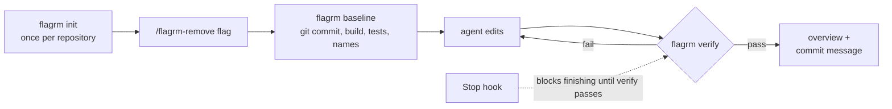

# flagrm

[](https://github.com/dino-cosic/flagrm/actions/workflows/ci.yml)
[](https://www.npmjs.com/package/flagrm)
[](https://nodejs.org)
[](LICENSE)

**Remove feature flags with your AI coding agent, safely.**

[Website](https://flagrm.com) · [Quick start](#quick-start) · [How it works](#how-it-works) · [Changelog](CHANGELOG.md)

Removing a feature flag looks easy: delete the `if`, keep the ON branch. In a
real codebase the flag hides behind wrappers and aliases, reaches templates and
config files, has tests for the OFF path, and leaves behind methods nothing
calls anymore. An AI agent handles most of that well, but it decides on its own
when it's done, and that's when it misses things.

flagrm gives Claude Code, GitHub Copilot and Codex a flag-removal skill and a
deterministic definition of "done":

- **The agent does the reasoning and the edits.** It finds the flag, its
  aliases and wrappers, removes the OFF path, and refactors the code the flag
  was passed into. flagrm never edits your source code.
- **flagrm decides when the removal is finished.** It records a baseline before
  the first edit, then `flagrm verify` fails while the flag is still
  referenced, the build breaks, a test or lint regresses, or the removal
  leaves unused code behind.
- **The agent doesn't stop early.** In Claude Code, a Stop hook keeps the
  agent from finishing until `verify` passes for the exact files on disk.

Angular and .NET projects work out of the box. Any other stack works through the
generic adapter.

> **Status:** flagrm is at version 0.4. Until 1.0, a minor release may contain
> breaking changes.

## Quick start

```sh
npm install -D flagrm        # or run everything with npx flagrm
npx flagrm init              # asks which AI tools; config, skills, Stop hook, .gitignore entry
```

Fill in the project paths and the build and test commands in
`flagrm.config.yaml`, check the setup with `npx flagrm doctor`, then ask your
agent:

```
/flagrm-remove NewCheckout
```

The agent ends with a short overview and a proposed commit message; it commits
only when you ask. The overview looks like this (abridged):

```md
### flagrm verify: NewCheckout ✅ pass

| Check | Status | Summary |
|---|---|---|
| leftovers | ✅ pass | no recorded name left in code or config |
| dead-code | ✅ pass | no new unused-code diagnostics |
| build | ✅ pass | web, api built successfully |
| tests | ✅ pass | tests passed (web 24 → 22: 2 deleted, 1 renamed; api 18 → 16: 2 deleted) |
| lint | ✅ pass | web linted cleanly |
| coverage | ✅ pass | every changed file is built, tested or linted |

**Files changed since baseline (26):** `backend/src/Shop.Api/Services/CheckoutService.cs`, ...

**Tests deleted (4):** `LegacyPricingCalculatorTests.AppliesBulkDiscount`, ...

**Tests renamed (1):** `CheckoutComponent › places the order when NewCheckout is on` → `CheckoutComponent › places the order`
```

- **Several flags:** `/flagrm-remove NewCheckout DarkMode` asks once whether
  they are all ON and whether to commit each, then removes them one after
  another, one commit each.
- **Independent review:** `/flagrm-review NewCheckout` in a new session runs
  `flagrm verify`, then checks what it can't: that the ON path is the code
  that stayed and that each deleted test covered only the OFF path. It
  reports findings and edits nothing.
- **Tests that no longer run** are sorted by why: deleted in the diff (the OFF
  path's tests), renamed without the flag in the name, or left out by a test
  command changed since the baseline. Only a test that no longer runs for none
  of these reasons is a warning, for the agent to explain in its notes.

### Requirements

- Node.js 22 or later
- git: `baseline` and `verify` compare against the commit the removal started from
- An AI coding agent that reads skills: Claude Code, GitHub Copilot or Codex
  (the Stop hook is Claude Code only)

No `package.json` (a pure .NET or Go repository)? Install globally with
`npm install -g flagrm`, or run `npx flagrm`. The Stop hook runs
`npx --no-install flagrm hook stop`, so it needs a local or a global install.

On Windows, the Stop hook runs in Git Bash, or in PowerShell when Git Bash is
not installed. In PowerShell, `npx` needs an execution policy that allows
scripts (`Set-ExecutionPolicy -Scope CurrentUser RemoteSigned`). Otherwise the
hook fails and does not guard the removal. `flagrm verify` still works.

## How it works



1. **`flagrm init`** asks which AI coding tools to set up (Claude Code,
   GitHub Copilot, Codex), with the ones the repository already uses
   pre-selected. It writes `flagrm.config.yaml` for the Angular and .NET
   projects it finds, adds `.flagrm/` to `.gitignore`, and installs each
   tool's files:

   | Tool | Files |
   |---|---|
   | Claude Code | `flagrm-remove` and `flagrm-review` skills in `.claude/skills/`, Stop hook in `.claude/settings.json` |
   | GitHub Copilot | skills in `.github/skills/`, `/flagrm-remove` and `/flagrm-review` prompt files in `.github/prompts/` |
   | Codex | skills in `.agents/skills/`, a pointer in `AGENTS.md` |

   `--tool claude-code,codex` answers without asking; without a terminal it
   takes the detected tools (all three when none is). The choice is saved as
   `tools:`. `init` never overwrites or deletes a file.
2. **`/flagrm-remove <flag>`**: the agent checks that the tree is clean and runs
   `flagrm baseline <flag>`, which records the git commit, the build and test
   results, and the flag's names. It finds every usage with its own search,
   records wrappers and aliases with `flagrm baseline <flag> --name`, removes
   the flag, and repeats `flagrm verify <flag>` until it passes.
3. **The Stop hook** (Claude Code) keeps the agent from finishing while a
   removal is in progress and not verified. In progress means a file git
   tracks changed on top of the baseline commit (untracked files and
   flagrm's own setup files don't count, so a removal paused on a question to
   the user doesn't block), the config changed in what it scans or ignores
   (such as `exclude`), or the last verify used `--skip`. It guards against
   finishing by accident, not an agent working around it: see
   [SECURITY.md](SECURITY.md#what-it-doesnt-guarantee).
4. **`/flagrm-review <flag>`** (optional), in a new session, reviews the
   removal: it runs `flagrm verify <flag> --json` and stops on a failure; on
   a pass it reads the diff since the baseline commit and checks that the ON
   path was kept, deleted tests covered only the OFF path, and nothing
   unrelated changed or lost a side effect. Its findings never change the
   verify result. A new session matters: an agent reviewing its own removal
   checks its own reasoning.

## What `verify` checks

| Check | Fails when |
|---|---|
| `leftovers` | A recorded name (the flag literal, its constants, wrappers the agent recorded) is still in code or config |
| `dead-code` | The compiler reports new unused code (locals, imports, private members) in changed files |
| `build` | A project's build command fails |
| `tests` | A test that passed at the baseline fails |
| `lint` | The project's `lint` command fails where it passed at the baseline |
| `coverage` | A changed file that no build, test or lint command checks (a warning, so it fails only with `--strict`) |

In typed code, deleting the flag's definition turns every missed reference into
a compile error, so the build does most of the work. `leftovers` covers what the
compiler cannot see: config files, templates, comments and wrappers.

<details>
<summary>Warnings and edge cases per check</summary>

- **`leftovers`**: a mention in a comment is a warning, and so is a test that
  checks text the removal deleted from the code (a test of the OFF path that
  never names the flag), or deleted text whose replacement on the same line no
  test checks (lost ON coverage).
- **`dead-code`**: a method, property, field or type the removal left named
  only where it is declared is a warning (compilers don't report public
  members).
- **`tests`**: tests that already failed at the baseline are known failures and
  only warn; without `testResults` they are read from the test log (Karma,
  Jest, Vitest, `dotnet test`), and count as known only when the log names
  every failing test. A test that no longer runs though the diff neither
  deletes nor renames it and the test config is unchanged, and a changed test
  file none of whose tests ran, are warnings for the agent to account for.
  Without `testResults`, deleted and renamed tests come from the changed test
  files, and a test count that dropped by more than the diff deletes is a
  warning (info when the changed test files use data rows such as
  `[InlineData]`, `TestCase`, `DataRow` or `.each`, whose cases count
  separately, or when the test config changed since the baseline).
- **`lint`**: a lint that already failed at the baseline only warns, unless its
  log has error lines the baseline's didn't (line and column numbers ignored);
  a missing package script or ESLint config is a setup problem and fails.
- **`coverage`**: a file counts as unchecked when it is outside every project
  with a command, or outside its `covers` globs. Files already dirty at the
  baseline and unchanged since don't count, nor do projects whose commands
  `--skip` left out.

The baseline also records the configuration it was taken with: each project's
resolved build, test and lint commands, the files they name (a `.slnf`, a
`.runsettings`, a filter list) and the text of `flagrm.config.yaml`. When any
of it changed since, the check it affects warns and shows the difference: a
narrower test command makes "no new failures" mean less.

</details>

## Commands

| Command | What it does | Exit codes |
|---|---|---|
| `init` | Set up the config, `.gitignore` entry and each chosen AI tool's files | 0, 2 usage error |
| `doctor` | Check the config, commands, toolchain, git setup, installed skills and hook | 0 ok, 1 problems |
| `scope` | Show which .NET projects this machine can't build and write a solution filter without them | 0 nothing missing, 1 something missing |
| `update` | Refresh the installed skills, prompt files, `AGENTS.md` block and hook | 0 |
| `list` | List every feature flag: definitions, configured state per environment, reference counts | 0 |
| `baseline <flag>` | Before any edit, record the git commit, build, test and lint results and the flag's names | 0, 2 usage error |
| `verify <flag>` | Gate the removal with the [checks above](#what-verify-checks) | 0 pass, 1 fail, 2 usage error |
| `stale [flags...]` | Ask LaunchDarkly which flags are ready to remove from code | 0 evaluated, 2 usage error, 3 LaunchDarkly unreachable or refused the request (token, access, project key) |
| `hook stop` | The Claude Code Stop hook installed by `init` | always 0 |

`list`, `baseline`, `verify` and `stale` accept `--json`, `--config <path>`, and
`--include` / `--exclude <glob>`.

<details>
<summary>Command details and options</summary>

- **`init`**: asks which tools to set up, or `--tool claude-code,copilot,codex`;
  saved as `tools:`. Never overwrites or deletes.
- **`doctor`**: checks the build, test and lint commands (marking adapter
  defaults; `--run` runs them and fails when tests write no readable
  `testResults`), the .NET SDK `global.json` asks for, `cargo` and Docker
  where projects need them, git, `.gitignore`, installed skills and hook, and
  abandoned baselines.
- **`scope`**: for each .NET project, shows what the machine lacks and which
  projects a solution filter would leave out; `--write` creates
  `flagrm.slnf`, adds it to `.git/info/exclude` and points the project's build
  and test at it. See [When the machine can't build everything](#when-the-machine-cant-build-everything).
- **`update`**: refreshes files from this flagrm version, for the config's
  `tools:`. It replaces the `flagrm-verify` skill and prompt file of earlier
  versions with `flagrm-review`, deleting them only when flagrm installed
  them.
- **`list`**: flow names include renamed imports of a flag registry
  (`import { FeatureFlags as AppFeatureFlags }`) and, in Angular, the fields,
  getters, methods and locals holding a flag and a child component's input
  bound to one.
- **`baseline <flag>`**: writes `.flagrm/<flag>/baseline.json`. In .NET and
  Angular code the names include the locals, fields, getters, parameters and
  methods the flag's value travels through when they name the flag (a local,
  parameter or field is checked only in its own file, and an Angular
  component's template); generic or ambiguous ones are listed as
  `suggestedNames`, with `parameterizedTests` that pass the value as a
  literal.
  - `--name X --kind alias|wrapper` adds names to an existing baseline (a name
    whose declaration reads only other flags is refused); `--file`
    (repeatable) limits `--name` entries to those files (and records them as
    wrappers).
  - `--json` prints a summary (test counts, at most 20 failed test names; the
    file keeps everything).
  - `--force` starts over, but only while the code is unedited since the
    baseline commit.
  - `--accept config,failures` acknowledges, also mid-removal, a config change
    or the baseline's failing tests so verify stops warning about them.
  - `--no-checks` skips build, tests and lint. Build, test and lint results of
    a passing verify on the same tree and commands are reused (`--no-reuse`
    runs them).
- **`verify <flag>`**: writes `.flagrm/<flag>/verify.json`. `--md` prints the
  overview, `--json` the full result, `--skip` skips checks, `--strict` fails
  on warnings. Reuses its own or another flag's passing runs on the same tree
  and commands (`--no-reuse` runs them).
- **`stale [flags...]`**: reads the config's `launchdarkly:` section
  (read-only) and sorts every flag, or the LaunchDarkly keys or code names
  given, into `remove`, `unreferenced` or `keep` with reasons. `--md` prints a
  markdown summary, `--json` the full result. See
  [LaunchDarkly and CI](#launchdarkly-and-ci).

</details>

## Configuration

```yaml
tools: [claude-code, codex]              # the AI tools init and update set up
projects:
  - name: web
    adapter: angular
    path: ./frontend
    build: npm run build
    test: npx ng test --watch=false
    testResults: ./frontend/test-results/junit.xml
    lint: npx eslint e2e && npx tsc --noEmit -p e2e   # optional lint / type-check
    covers: ['src/**', 'e2e/**']         # what the commands check (default: everything under path)
    methods: [isEnabled, watch]          # flag evaluation methods
  - name: api
    adapter: dotnet
    path: ./backend
    build: dotnet build --no-incremental
    test: dotnet test --logger trx --results-directory TestResults
    testResults: ./backend/TestResults/*.trx
  - name: service
    adapter: generic                     # any other stack
    path: ./service
    globs: ['**/*.go', 'config/**/*.yaml']
    methods: [IsEnabled]
exclude: ['**/Migrations/**']
```

Paths are relative to the config file, and commands run inside each project's
path. `build` and `test` are resolved one at a time:

| In the config | Command that runs |
|---|---|
| absent | the adapter's default (`dotnet build --no-incremental`, `npx ng build`, and so on) |
| a command | that command |
| `false` | none, not even the default |

| Key | What it does |
|---|---|
| `testResults` | JUnit XML, TRX or Jest JSON (a path or a glob), so `verify` compares individual tests against the baseline |
| `lint` | Optional lint or type-check command, run like `build` and `test` |
| `covers` | Globs (relative to `path`) of the files the project's commands check |
| `timeout` | Seconds after which a build or test command fails, for example a test runner left in watch mode |
| `tools` | The AI coding tools whose files `init` and `update` manage (`claude-code`, `copilot`, `codex`) |
| `exclude` | Paths that don't count as part of a removal |

**`testResults`.** Only files written during the run are read, and every
matching file is merged, so a sharded run can use `./test-results/*.xml`. The
default .NET test command writes TRX to `.flagrm/test-results/<project>/`. So
does the default Angular test command, when the workspace's runner can write
results without setup: JUnit for Angular's Vitest builder and Vitest, Jest JSON
for Jest, and JUnit for Karma once karma.conf configures
`karma-junit-reporter`. A `test` command of your own needs its own
`testResults`, and `flagrm doctor` says what to add. Without result files,
`verify` reads failing test names and counts from the test log and deleted
tests from the diff, which is coarser: passing tests aren't named.

**`lint`** has no adapter default. Use it for code the build and tests don't
reach, such as end-to-end specs. A lint that already fails at the baseline only
warns, unless the removal adds error lines. flagrm doesn't check formatting:
put a formatter's check (`npx prettier --check .`) in `lint` if you want it.

**`covers`.** The `coverage` check warns about a changed file no project with a
command covers. Without `covers`, a project covers everything under its path.

**`tools`.** Dropping a tool leaves its files in place, and `init` names them so
you can delete them.

**`exclude`.** Paths matching `exclude` (relative to the config file or a
project's path; a directory excludes everything under it) and flagrm's own
setup files don't count as part of a removal, so generated output such as
`graphify-out/` that changes during a session doesn't invalidate a passing
verify or block the Stop hook. `--exclude` on the command line doesn't reach
the Stop hook.

### LaunchDarkly

An optional `launchdarkly:` section lets `flagrm stale` read the project's
flags from LaunchDarkly (see [LaunchDarkly and CI](#launchdarkly-and-ci)):

```yaml
launchdarkly:
  project: shop                           # required: the LaunchDarkly project key
  baseUrl: https://app.launchdarkly.com   # default; EU and federal instances use their own
  tokenEnv: LD_API_TOKEN                  # default; the variable holding the API token
  environments: [production, staging]     # default: every environment of the project
  minDaysOn: 30                           # default: days every environment must have served true
  temporaryOnly: true                     # default: only flags marked temporary qualify
  tags: { include: [], exclude: [permanent] }   # must have every include tag and no exclude tag
  map: { checkout-v2: NewCheckout }       # LaunchDarkly key → code name, when the spelling differs
```

The API token is read only from the variable `tokenEnv` names; a `token` or
`apiKey` in the file is an error. It is sent only to `baseUrl`, which must use
`https` (plain `http` only to `localhost`). A reader role is enough: flagrm
never writes to LaunchDarkly. Without the section nothing changes, and
`flagrm doctor` warns when the token variable isn't set.

### When the machine can't build everything

`flagrm init` and `flagrm doctor` check that the .NET SDK `global.json` asks
for is installed (honoring `rollForward`), that `cargo` is on PATH when a
project's build runs it, and that Docker is running when a test project uses
Testcontainers. A missing SDK has to be installed. For `cargo` or Docker,
`flagrm scope` shows which projects a solution filter would leave out: those
projects and everything that references them. `flagrm scope --write` creates
`flagrm.slnf` next to the solution, keeps it out of git, and points the
project's `build` and `test` at it. The baseline and verify then run on what
the machine can build; edits to the left-out projects aren't checked by
build or tests, so mention them in the PR.

A test that fails only because of the machine's locale (a decimal comma, a
date format) is best left out by name, for example `dotnet test --filter
"FullyQualifiedName!=Ns.PriceTests.FormatsTotal"`, rather than by forcing
`LC_ALL=en_US.UTF-8` for the whole run: changing the locale for every test
can break others that pass today.

For .NET, keep `--no-incremental` in `build`. An incremental build skips
up-to-date projects and prints none of their warnings, so the dead-code check
would have no baseline warnings to compare against.

## LaunchDarkly and CI

With a [`launchdarkly:` section](#launchdarkly) in the config, `flagrm stale`
reads the project's flags from LaunchDarkly and compares them with the code
(`flagrm list`'s inventory). Each flag gets one verdict:

| Verdict | Meaning |
|---|---|
| `remove` | Meets every condition, and one code name in this repository matches it |
| `unreferenced` | No code name in this repository matches it. Another repository may still read it, so this is not a suggestion to archive it |
| `keep` | Anything else, with the reasons: still targeted somewhere, serving `false`, on for too few days, permanent, a tag, an ambiguous name, data flagrm couldn't read, or a code name with no LaunchDarkly flag (archived or deleted: the SDK serves the code's fallback, which may be OFF) |

A flag meets the conditions when it is boolean, every checked environment
serves `true` to every context (no rules, individual targets, prerequisites or
rollouts; or targeting off with `true` as the off variation) and has for at
least `minDaysOn` days, it is marked temporary (unless `temporaryOnly: false`),
and its tags pass `tags`. The days count from the latest targeting change in
the audit log; a name, description or tag edit doesn't reset them. Without one,
they count from the environment's last change of any kind (marked `*`), which
can only make a flag wait longer. Set `environments` when the project has
per-developer or short-lived environments: by default every environment must
serve `true`. A LaunchDarkly key matches a code name through `map`, then by
exact name, then ignoring case and `-`, `_`, `.` and spaces (`new-checkout`
matches `NewCheckout`); two possible matches are reported, not guessed.

`stale` exits 0 whenever it could evaluate, whatever the verdicts: read them
from `--json`. Exit 2 is a usage or config error (no section, no token, an
unknown environment or flag name). Exit 3 means LaunchDarkly couldn't be
reached or refused the request: it rejected the token, the token may not read
the project, or it doesn't know the project key. A wrong project key is
reported this way because LaunchDarkly gives the same answer when the token
belongs to another organization or `baseUrl` points at another instance. A
token with LaunchDarkly's reader role is enough; flagrm only sends GET
requests.

When the config has `launchdarkly:`, the `flagrm-remove` skill runs
`flagrm stale <flag> --json` instead of asking whether a flag set only in
LaunchDarkly is ON everywhere, so a removal can run without anyone there.
[`examples/ci/github-actions.yml`](examples/ci/github-actions.yml) and
[`examples/ci/azure-pipelines.yml`](examples/ci/azure-pipelines.yml) run it on
a weekly schedule: they list the `remove` flags, run a headless Claude Code
agent per flag, run `flagrm verify` themselves and open a pull request only
when it passes. The agent job needs the project's build toolchain, and the
pull request is for a person to review.

## Separate repositories

flagrm works per git repository: the baseline is a commit of one repository,
and the config, `.flagrm/`, skills and hook live in its root. With the UI and
the backend in separate repositories, run `flagrm init` in each (the Angular
adapter in one, .NET in the other) and run `/flagrm-remove <flag>` in each.
flagrm does not coordinate the two: each repository gets its own verdict, the
agent has to record the flag's name in each (it may differ between UI and
API), and the order of the two removals is up to you.

## Development

```sh
npm install
npm run ci      # typecheck, lint, build, tests
npm run dev -- list --config test/fixtures/realistic/before/flagrm.config.yaml
```

`test/fixtures/realistic` holds a before and after pair from a real removal
(Angular and .NET). The `verify` tests run against it.

See [CONTRIBUTING.md](CONTRIBUTING.md) for how to report a bug or send a pull
request, and [CHANGELOG.md](CHANGELOG.md) for what changed between versions.

## License

Licensed under the [Apache License, Version 2.0](LICENSE). See [NOTICE](NOTICE) for attribution.
